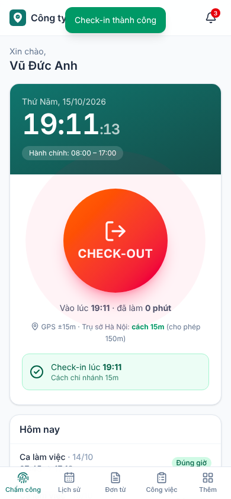
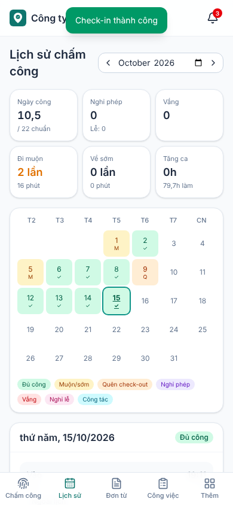
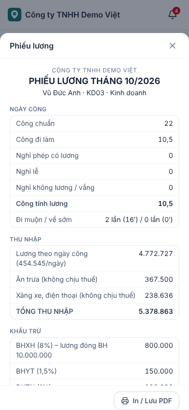
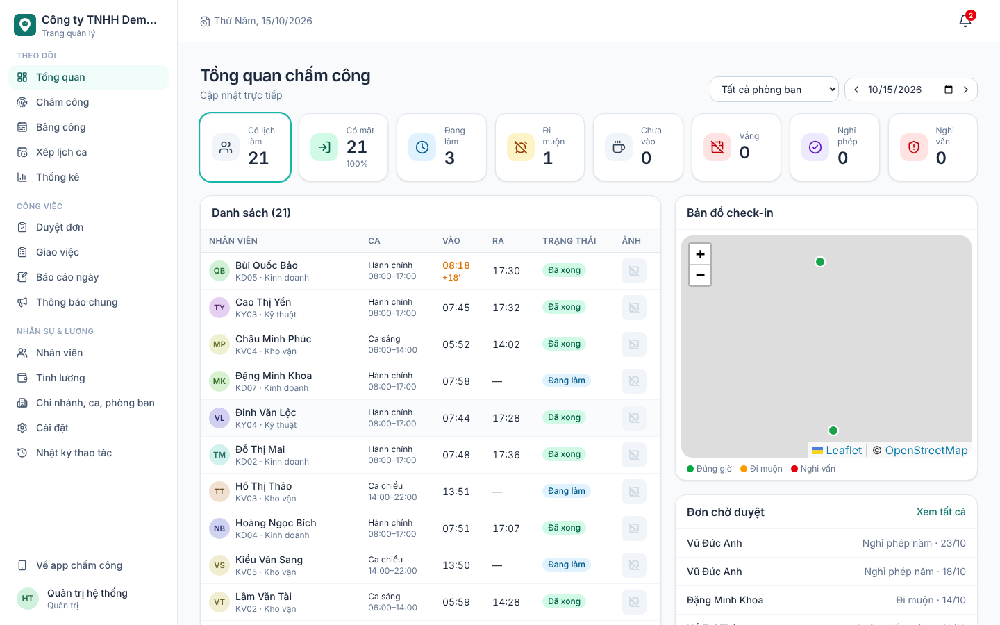
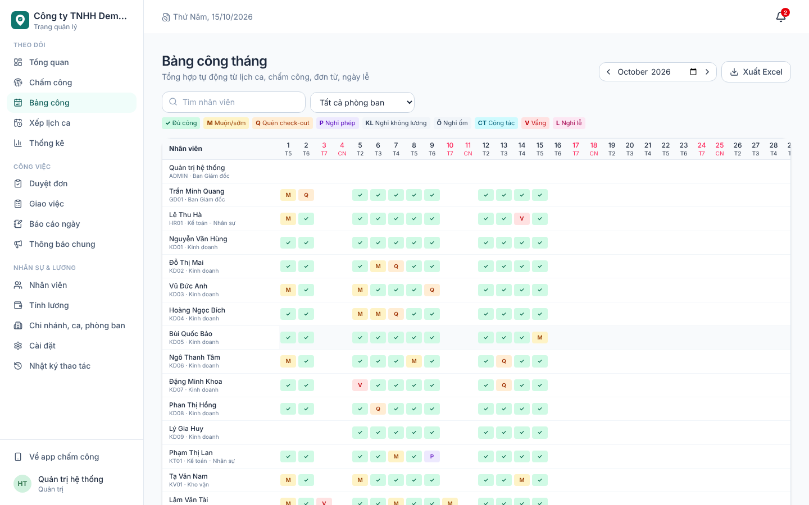
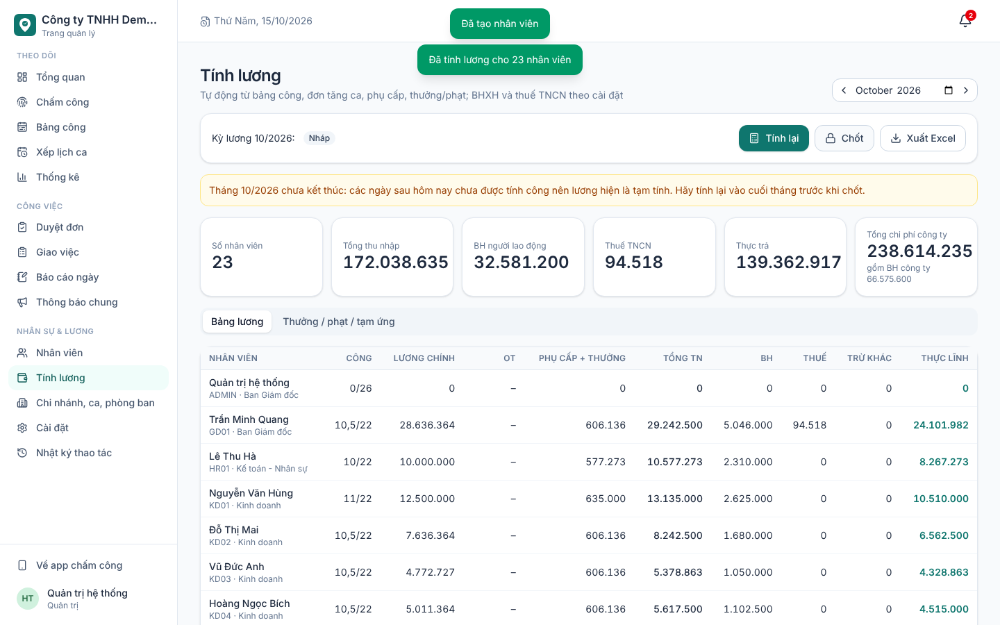

# Chấm công – GPS, selfie, đơn từ, công việc, tính lương

Phần mềm chấm công và quản lý nhân sự cho doanh nghiệp nhiều chi nhánh, thiết kế cho khoảng 300 nhân viên (mở rộng thêm được).

- **App nhân viên**: chạy trên điện thoại dưới dạng PWA, cài từ trình duyệt, không cần lên App Store hay CH Play.
- **Trang quản lý**: dành cho quản lý, HR và kế toán, dùng trên máy tính.
- **Máy chủ**: Supabase (PostgreSQL). Thiết kế để chuyển sang VPS tự quản bất kỳ lúc nào, xem [deploy/vps/README.md](deploy/vps/README.md).

| App nhân viên | | |
|---|---|---|
|  |  |  |





## Tính năng

**Chấm công và chống gian lận**
- Check-in/out bằng GPS. Hệ thống chỉ chấp nhận khi nhân viên ở trong bán kính chi nhánh được gán, và kiểm tra cả độ chính xác của GPS.
- Chụp selfie lúc chấm công (có đóng dấu thời gian lên ảnh). Ảnh lưu riêng tư, chỉ quản lý của nhân viên đó xem được.
- Khoá thiết bị: mỗi người chỉ chấm công trên một điện thoại. Muốn đổi máy phải gửi đơn để HR duyệt.
- Phát hiện bất thường: app giả lập vị trí, vị trí "nhảy" nhanh vô lý giữa 2 lần chấm, GPS chính xác bất thường, chấm ngoài lịch hoặc khác chi nhánh. Quản lý được báo ngay.
- Mọi kiểm tra đều chạy trên máy chủ, không tin dữ liệu từ điện thoại. Giờ chấm công lấy theo giờ máy chủ.

**Ca làm việc**
- Hỗ trợ ca hành chính, ca xoay, ca đêm (qua ngày) và ca gãy (nhiều ca trong một ngày).
- Mỗi nhân viên có lịch mặc định (ca và các ngày làm trong tuần), quản lý có thể xếp lịch cụ thể từng ngày.
- Xếp lịch hàng loạt, chép lịch tuần trước.
- Cấu hình được thời gian cho phép đi muộn/về sớm, giờ nghỉ giữa ca, số công của từng ca.
- Quản lý ngày lễ.

**Đơn từ và duyệt nhiều cấp**
- Các loại đơn: nghỉ phép năm, nghỉ ốm, nghỉ không lương, nghỉ chế độ, công tác, tăng ca, giải trình đi muộn/về sớm, quên chấm công, đổi ca với đồng nghiệp, đổi thiết bị.
- Quy trình duyệt cấu hình riêng cho từng loại đơn, ví dụ quản lý trực tiếp → trưởng phòng → nhân sự.
- Khi đơn được duyệt, hệ thống tự áp dụng: bổ sung giờ chấm, miễn lỗi đi muộn, hoán đổi ca, đổi thiết bị.
- Quỹ phép năm cộng dồn theo tháng, có thâm niên (+1 ngày mỗi 5 năm) và phép tồn năm trước.

**Công việc và báo cáo**
- Giao việc cho một hoặc nhiều người, có mức ưu tiên, hạn chót, tiến độ, đính kèm và trao đổi.
- Báo cáo ngày gồm việc đã làm, đang làm, khó khăn và kế hoạch. Quản lý chấm sao và nhận xét.
- Có thể bắt buộc nộp báo cáo trước khi check-out.

**Tính lương**
- Lương theo tháng (theo ngày công), theo giờ hoặc theo ca.
- Phụ cấp cố định (theo tháng hoặc theo ngày công, chịu thuế hoặc không), thưởng, phạt, tạm ứng (nhập được từ Excel).
- Tăng ca theo hệ số ngày thường, ngày nghỉ và ngày lễ. Phần chênh lệch tiền tăng ca được miễn thuế TNCN.
- Bảo hiểm bắt buộc phần người lao động (BHXH 8%, BHYT 1,5%, BHTN 1%) có áp trần, đoàn phí. Tự động không đóng bảo hiểm khi nghỉ không lương từ 14 ngày trở lên.
- Thuế TNCN theo biểu lũy tiến, có giảm trừ gia cảnh và người phụ thuộc. Mọi tỷ lệ chỉnh được trong Cài đặt.
- Phạt đi muộn, về sớm, vắng mặt theo cấu hình.
- Quy trình kỳ lương: Tính lương → Chốt (khoá luôn dữ liệu chấm công của tháng) → Công bố (nhân viên nhận thông báo và xem phiếu lương).
- Xuất Excel bảng lương và danh sách chuyển khoản. Phiếu lương in hoặc lưu PDF được.

**Thông báo**
- Nhắc check-in trước giờ vào ca, nhắc check-out khi hết ca.
- Báo vắng mặt cho cả nhân viên và quản lý, đánh dấu quên check-out.
- Thông báo đơn cần duyệt và kết quả duyệt, việc mới, việc sắp đến hạn hoặc quá hạn, phiếu lương.
- Thông báo chung gửi tới toàn công ty, một phòng ban hoặc một chi nhánh.
- Kênh gửi: trong app (thời gian thực), Web Push lên điện thoại, Telegram và Email (tuỳ chọn).

**Trang quản lý**
- Tổng quan trực tiếp: ai đang làm, đi muộn, vắng, nghỉ phép, chấm công nghi vấn. Có bản đồ vị trí check-in và biểu đồ 14 ngày.
- Chấm công chi tiết kèm ảnh, khoảng cách và cờ nghi vấn. HR sửa hoặc thêm thủ công được, mọi thay đổi đều ghi nhật ký.
- Bảng công tháng dạng lưới, xuất Excel.
- Thống kê: chuyên cần theo phòng ban, xếp hạng đi muộn, vắng, tăng ca, đơn từ, quỹ lương 6 tháng.
- Quản lý nhân viên: nhập/xuất Excel (có file mẫu), lương, phụ cấp, chi nhánh, tài khoản, đặt lại mật khẩu, khoá tài khoản khi nghỉ việc, gỡ thiết bị.
- Chi nhánh (chọn vị trí trên bản đồ, đặt bán kính), phòng ban, chức vụ, ca, ngày lễ.
- Nhật ký thao tác: ai sửa gì, trước và sau ra sao.

**Phân quyền**

| Vai trò | Quyền |
|---|---|
| Nhân viên | Chấm công, đơn từ, công việc, báo cáo, phiếu lương của chính mình |
| Trưởng nhóm / Quản lý | Thêm quyền xem chấm công, xếp lịch, duyệt đơn, giao việc, nhận xét báo cáo cho **cấp dưới** (theo cây quản lý trực tiếp và phòng ban mình quản lý). **Không xem lương.** |
| Nhân sự / Kế toán | Toàn bộ nhân sự, chấm công, lương, cài đặt |
| Quản trị | Như Nhân sự, cộng thêm quyền mở lại kỳ lương đã chốt và tạo tài khoản Quản trị |

Phân quyền được thực thi ở **database** (Row Level Security), không chỉ ẩn trên giao diện.

## Kiến trúc

```
Điện thoại / Máy tính (React PWA)
        │  src/lib/api/*  ← lớp duy nhất gọi máy chủ (đổi backend chỉ sửa ở đây)
        ▼
Supabase: PostgreSQL + Auth + Storage + Realtime + Edge Functions + pg_cron
  supabase/migrations/   bảng, phân quyền RLS, hàm check_in/check_out, duyệt đơn, nhắc nhở
  supabase/functions/    admin-users (tạo tài khoản), push-dispatch (gửi thông báo), cleanup (dọn ảnh)
```

```
src/
  pages/employee/   app nhân viên       pages/admin/   trang quản lý
  pages/shared/     dùng chung (duyệt đơn, công việc, thông báo)
  lib/payroll/      bộ máy tính công & lương (TypeScript thuần, có unit test)
  lib/api/          kết nối máy chủ
scripts/            tạo admin, dữ liệu mẫu, test backend, sao lưu/chuyển dữ liệu
deploy/vps/         hướng dẫn & cấu hình chuyển sang VPS
```

## Chạy thử trên máy

Cần Node.js 20+ và Docker.

```bash
npm ci
npx supabase start                        # khởi động Supabase cục bộ (lần đầu tải image hơi lâu)
npx supabase status -o env                # lấy API_URL, ANON_KEY, SERVICE_ROLE_KEY
```

Tạo file `.env.local`:

```
VITE_SUPABASE_URL=http://127.0.0.1:54321
VITE_SUPABASE_ANON_KEY=<ANON_KEY>
SUPABASE_SERVICE_ROLE_KEY=<SERVICE_ROLE_KEY>
```

Tạo `supabase/functions/.env`, chỉ dùng khi chạy local:

```
CRON_SECRET=test-cron-secret
LOGIN_EMAIL_DOMAIN=nv.local
VAPID_PUBLIC_KEY=...      # npx web-push generate-vapid-keys
VAPID_PRIVATE_KEY=...
```

```bash
npx supabase functions serve --env-file supabase/functions/.env   # cửa sổ riêng
npm run seed-demo         # dữ liệu mẫu: 2 chi nhánh, 22 nhân viên, lịch sử chấm công cả tháng
npm run dev               # mở http://localhost:5173
```

Tài khoản mẫu, tất cả dùng mật khẩu `Demo@123`:

| Mã | Vai trò |
|---|---|
| `ADMIN` | Quản trị |
| `HR01` | Nhân sự |
| `KD01` | Quản lý phòng Kinh doanh |
| `KD02` | Trưởng nhóm |
| `KD03` | Nhân viên |

Kiểm thử:

```bash
npm test          # 19 unit test bộ tính công/lương
npm run test:db   # 83 test tích hợp backend: GPS, selfie, thiết bị, RLS, duyệt đơn, kỳ lương, nhắc nhở…
```

## Triển khai lên Supabase Cloud

1. **Tạo project** tại <https://supabase.com>, chọn region **Singapore** cho gần Việt Nam.
2. **Đẩy database:**
   ```bash
   npx supabase login
   npx supabase link --project-ref <REF>
   npx supabase db push
   ```
3. **Cấu hình đăng nhập.** Vào Dashboard → Authentication → Sign In / Providers:
   - Tắt **Allow new users to sign up**. Tài khoản do HR tạo.
   - Giữ **Email** bật.
   - Tắt **Confirm email**.
4. **Khoá bí mật cho Edge Functions:**
   ```bash
   npx web-push generate-vapid-keys    # sinh cặp khoá thông báo đẩy
   npx supabase secrets set \
     CRON_SECRET="$(openssl rand -hex 24)" \
     LOGIN_EMAIL_DOMAIN=nv.local \
     APP_URL=https://chamcong.congty.vn \
     VAPID_PUBLIC_KEY=... VAPID_PRIVATE_KEY=... VAPID_SUBJECT=mailto:admin@congty.vn
   # tuỳ chọn: TELEGRAM_BOT_TOKEN=... RESEND_API_KEY=... EMAIL_FROM="Chấm công <noreply@congty.vn>"
   npx supabase functions deploy
   ```
5. **Bật tác vụ định kỳ.** Chạy trong SQL Editor, dùng đúng `CRON_SECRET` ở bước 4:
   ```sql
   select app.set_config('functions_url', 'https://<REF>.supabase.co/functions/v1');
   select app.set_config('cron_secret', '<CRON_SECRET>');
   ```
6. **Tạo tài khoản Admin đầu tiên.** Lấy service_role key ở Dashboard → Project Settings → API Keys:
   ```bash
   SUPABASE_URL=https://<REF>.supabase.co SUPABASE_SERVICE_ROLE_KEY=<service_role> \
     npm run create-admin -- --code ADMIN --name "Tên của bạn" --password "MatKhauManh@2026"
   ```
7. **Đưa ứng dụng lên mạng.** Bắt buộc dùng **HTTPS**, vì điện thoại chỉ cho dùng GPS và camera trên HTTPS.
   ```bash
   npm run build
   ```
   Sửa `dist/config.js` với `supabaseUrl`, `supabaseAnonKey` (anon/publishable key), `vapidPublicKey`. Sau đó tải thư mục `dist/` lên một dịch vụ host tĩnh bất kỳ: Cloudflare Pages, Netlify, Vercel, hoặc web server của công ty.

### Cài app lên điện thoại

- **Android (Chrome):** mở địa chỉ ứng dụng → menu ⋮ → *Cài đặt ứng dụng* (hoặc *Thêm vào màn hình chính*).
- **iPhone (Safari):** nút Chia sẻ → *Thêm vào MH chính*. Thông báo đẩy trên iPhone cần iOS 16.4 trở lên **và** phải mở app từ biểu tượng ngoài màn hình chính.

### Thiết lập ban đầu (Admin/HR)

1. **Chi nhánh, ca, phòng ban:** tạo chi nhánh (bấm lên bản đồ hoặc dùng *vị trí hiện tại* khi đang đứng tại văn phòng, bán kính 50–150 m), tạo các ca, phòng ban, chức vụ và ngày lễ (Tết và Giỗ Tổ nhập theo lịch từng năm).
2. **Cài đặt:** quy trình duyệt, hệ số tăng ca, mức phạt, bảo hiểm, biểu thuế. **Kiểm tra lại mức giảm trừ gia cảnh và biểu thuế theo quy định hiện hành.**
3. **Nhân viên:** tải *File mẫu*, điền danh sách rồi *Nhập Excel*. Có thể khai cả mã quản lý, chi nhánh, ca mặc định và lương.
4. Gửi cho nhân viên địa chỉ app, mã nhân viên và mật khẩu ban đầu. Lần check-in đầu tiên sẽ đăng ký điện thoại của họ.

## Quy tắc tính công

- **Công chuẩn:** số ngày làm việc trong tháng theo lịch tuần của từng người, hoặc một số cố định (ví dụ 26) tuỳ cài đặt.
- **Ngày có ca:** có check-in và check-out thì đủ công của ca. Quên check-out thì được phần công theo cài đặt (mặc định 0,5), muốn đủ công phải gửi đơn *Quên chấm công*.
- **Nghỉ phép năm / nghỉ chế độ / công tác:** được tính lương. **Nghỉ ốm / không lương:** không tính lương công ty.
- **Ngày lễ có lương:** tính công cho người có ngày đó là ngày làm việc.
- **Tăng ca:** chỉ tính **giờ trong đơn tăng ca đã duyệt**.
- **Lương tháng** = lương ÷ công chuẩn × (công đi làm + phép + lễ).

## Chi phí ước tính (300 nhân viên)

| Hạng mục | Chi phí |
|---|---|
| Supabase **Pro** (khuyên dùng: sao lưu hằng ngày, 8 GB DB, 100 GB lưu trữ) | ~25 USD/tháng |
| Supabase Free (dùng thử) | 0 đ. Giới hạn 1 GB ảnh, tương đương khoảng 3 tháng selfie, có thể giảm *Lưu ảnh selfie* xuống 60–90 ngày |
| Host ứng dụng (Cloudflare Pages / Netlify) | 0 đ |
| VPS tự quản (sau này) | ~300–600 nghìn đ/tháng cho 4–8 GB RAM |

Dung lượng thực tế mỗi tháng: khoảng 6.600 lượt chấm công (vài MB dữ liệu) và khoảng 260 MB ảnh selfie (40 KB/ảnh). Ảnh quá hạn lưu trữ được tự xoá lúc 2 giờ sáng.

## Bảo mật và giới hạn cần biết

- **GPS trên trình duyệt vẫn có thể bị làm giả** bằng app chuyên dụng trên máy đã root hoặc jailbreak. Vì vậy hệ thống kết hợp **GPS + selfie + khoá thiết bị + phát hiện bất thường**, và quản lý nên xem mục *Nghi vấn* trên trang Tổng quan.
- Mật khẩu do Supabase Auth quản lý (mã hoá bcrypt). Khoá `service_role` chỉ dùng cho script quản trị, **không bao giờ** đặt vào frontend.
- Dữ liệu tháng đã chốt lương bị khoá ở database, kể cả HR cũng không sửa được nếu Admin không mở lại kỳ lương.

## Chuyển sang VPS

Xem hướng dẫn từng bước tại [deploy/vps/README.md](deploy/vps/README.md). Các script đi kèm, đã được kiểm thử:

| Script | Việc làm |
|---|---|
| `scripts/apply-migrations.sh` | Tạo database |
| `scripts/db-export.sh` / `scripts/db-import.sh` | Chuyển dữ liệu và tài khoản |
| `scripts/migrate-storage.mjs` | Chuyển ảnh |
| `deploy/vps/backup.sh` | Sao lưu hằng ngày |
